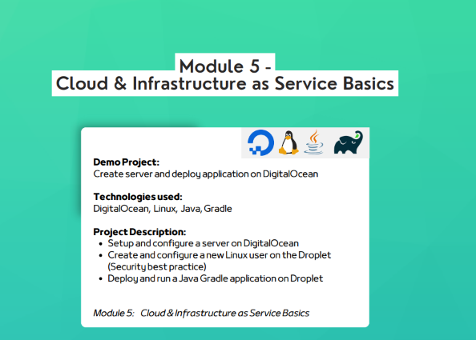
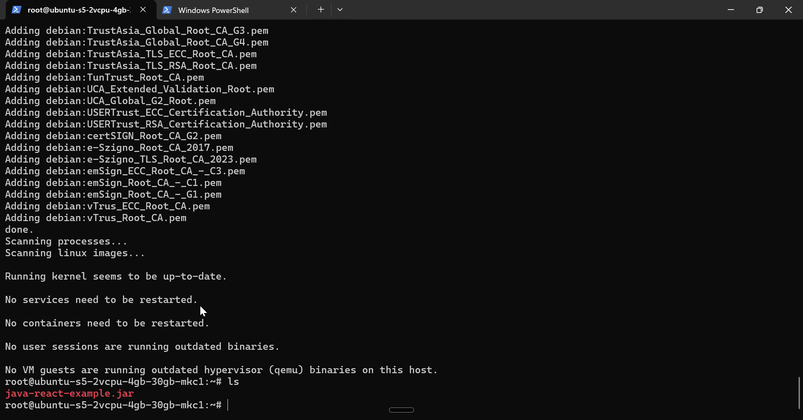
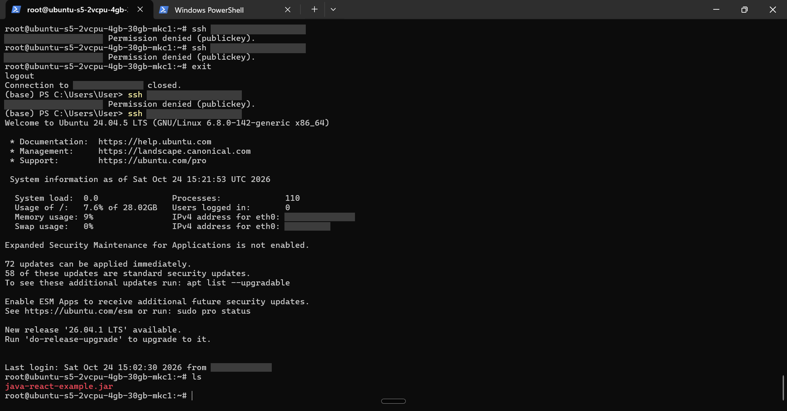
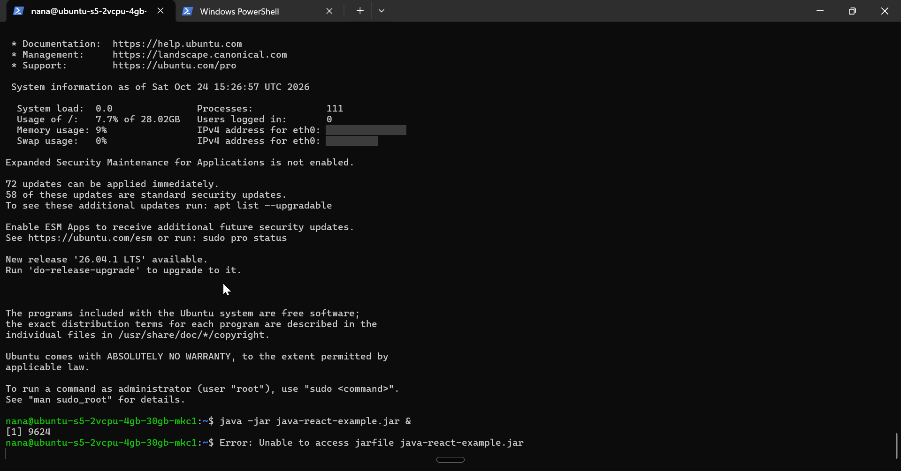
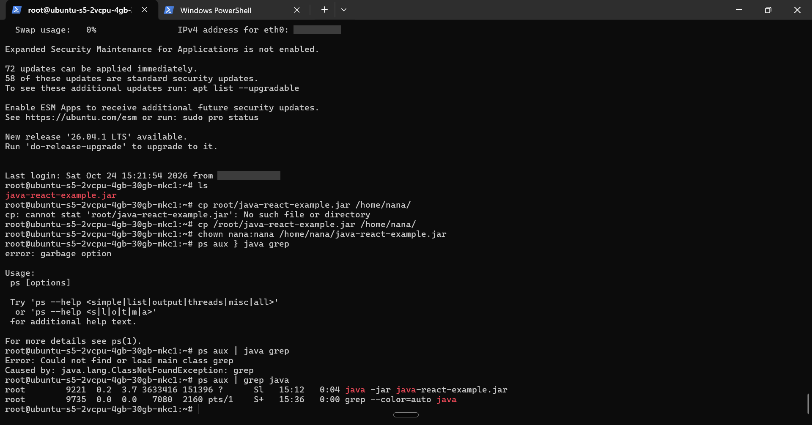
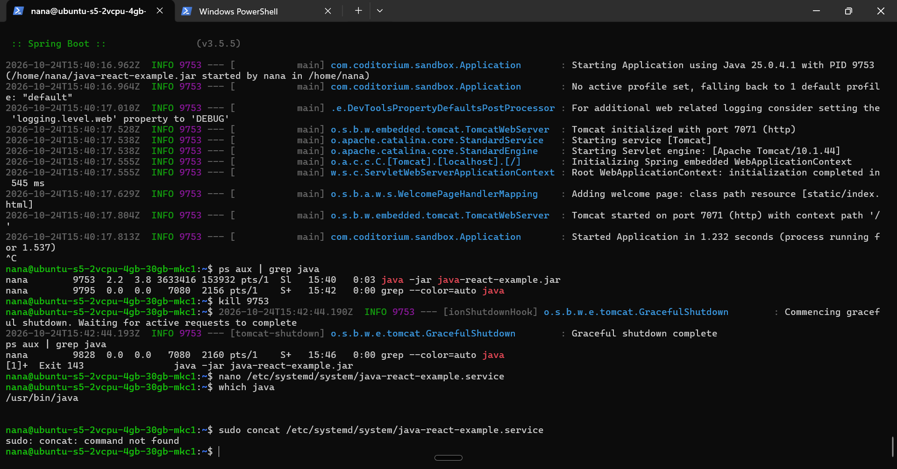
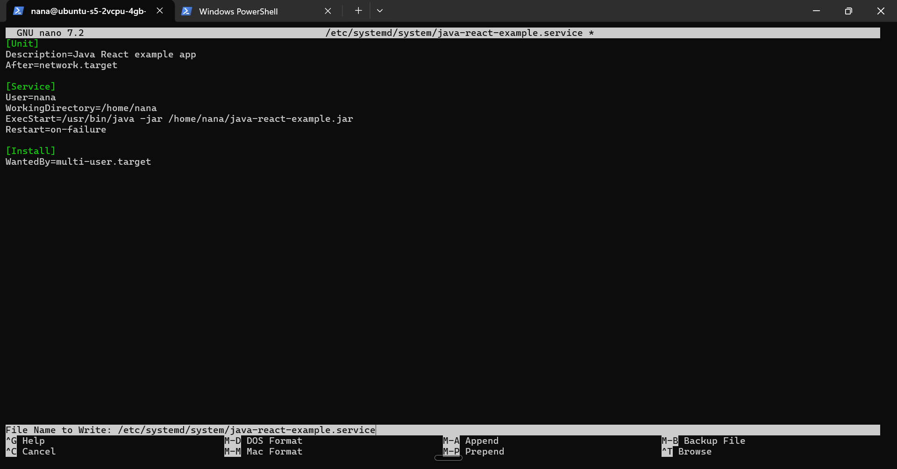
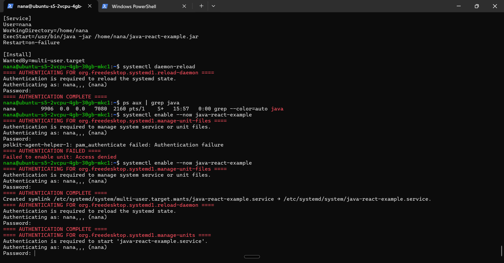
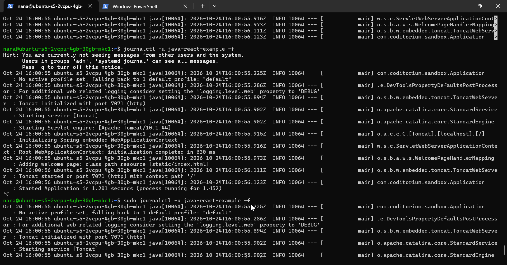
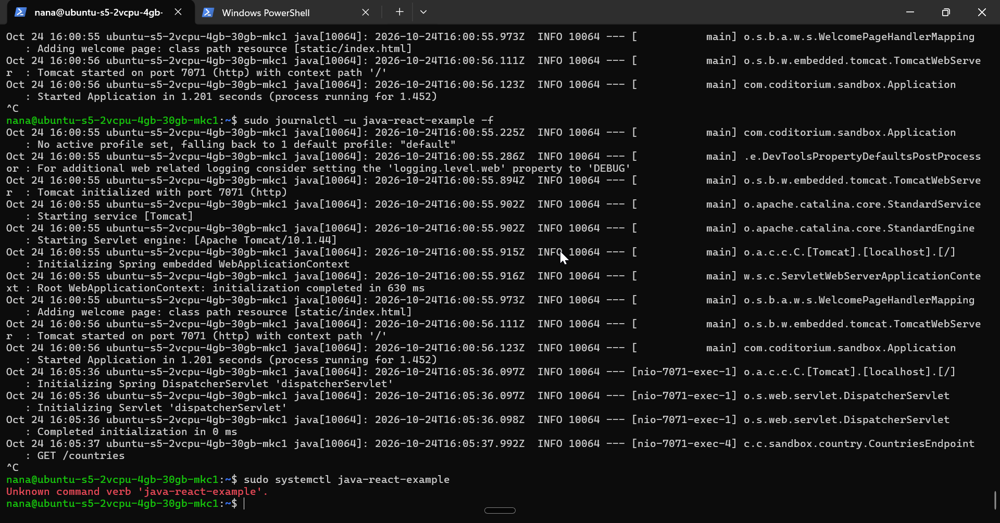

# Deploy a Java Gradle App on a DigitalOcean Droplet

**TechWorld with Nana DevOps Bootcamp, Module 5: Cloud & Infrastructure as Service Basics**



## Project

Create a server and deploy an application on DigitalOcean.

**Technologies:** DigitalOcean, Linux (Ubuntu 24.04), Java, Gradle, systemd

**What I did:**

- Set up and configured a server (Droplet) on DigitalOcean
- Created and configured a new Linux user on the Droplet (security best practice)
- Deployed and ran a Java Gradle application on the Droplet
- Extra: moved the app from a manual `java -jar &` to a proper **systemd service**

> IP addresses are redacted in commands and screenshots. `<droplet-ip>` = the server's public IP.

---

## Steps

### 1. SSH into the remote server

```bash
ssh root@<droplet-ip>
```

### 2. Find my IP

Run on the server. The first value is the IP the server sees me connecting from.

```bash
echo $SSH_CLIENT
```

### 3. Configure firewall and limit incoming traffic to only my IP

In the DigitalOcean firewall, allowed inbound traffic only from my IP:

- SSH (port 22)
- App port (7071)

### 4. Update apt and install Java on the remote server

```bash
apt update
apt install openjdk-<version>-jre-headless
java -version
```



### 5. Build my local app

```bash
gradle build
```

### 6. Copy the local jar file to the remote server

Run on my laptop, not the server.

```bash
scp build/libs/java-react-example.jar root@<droplet-ip>:/root
```

### 7. Run the jar file in detached mode

```bash
java -jar java-react-example.jar &
```

### 8. Observe the running process

```bash
ps aux | grep java
apt install net-tools
netstat -lntp
```

`netstat -lntp` shows which port the app is listening on (7071).

### 9. Create a user

Running everything as root is not best practice, so I created a normal user with sudo rights.

```bash
adduser nana
usermod -aG sudo nana
su - nana
exit
```

### 10. SSH didn't work for the new user, so I configured SSH for it

`ssh nana@<droplet-ip>` failed with `Permission denied (publickey)`.

**Why:** my laptop's public key was only in root's `authorized_keys`. The new user had none.

Also, my first tries ran `ssh` from *inside* the server, which uses the server's keys, not my laptop's. So they would fail either way.



As root:

```bash
cd /home/nana
mkdir .ssh
ls -a
vim .ssh/authorized_keys
# i, <paste my public SSH key>, Esc, :wq
exit
```

Then from my laptop:

```bash
ssh nana@<droplet-ip>
java -jar java-react-example.jar &
```

### 11. The app didn't run as nana, because the jar was in root's home

`Error: Unable to access jarfile` means Java can't find the file.

As nana, `~` is `/home/nana`. The jar was in `/root`.



Copied the jar to nana's home, gave nana ownership, and stopped the copy running as root:

```bash
exit
ssh root@<droplet-ip>
cp /root/java-react-example.jar /home/nana/
chown nana:nana /home/nana/java-react-example.jar
ps aux | grep java
kill 9221
rm /root/java-react-example.jar
su - nana
ls
java -jar java-react-example.jar &
```

`chown` only changes the copy in `/home/nana`. The original in `/root` stays owned by root. So I removed the root copy, so it can't accidentally be run as root again.



### 12. Extra: running the app with systemd

The app worked, but I found out `java -jar &` is not how apps are run on production servers.

```bash
# stop the manually started app
ps aux | grep java
kill 9753
```

Plain `kill` sends SIGTERM, a polite shutdown. The app logged `Graceful shutdown complete`, and the job exited with code `143` (128 + 15, where 15 = SIGTERM).



Created the service file. Writing to `/etc/systemd/system` needs root, so `sudo` is required when logged in as nana:

```bash
sudo nano /etc/systemd/system/java-react-example.service
# paste [Unit], [Service] & [Install] info, Ctrl+O + Enter + Ctrl+X

# check the write was successful
cat /etc/systemd/system/java-react-example.service
```

The file is in [`systemd/java-react-example.service`](systemd/java-react-example.service).



Load and start it:

```bash
sudo systemctl daemon-reload
sudo systemctl enable --now java-react-example
```

Without `sudo`, polkit asks for the password once per action, so `enable --now` asked 3 times (enable, reload, start). `sudo` asks once.



Manage and observe it:

```bash
sudo systemctl status java-react-example     # app status
sudo journalctl -u java-react-example -f     # app logs
sudo systemctl stop java-react-example
sudo systemctl start java-react-example
sudo systemctl restart java-react-example
```



The logs show `GET /countries`, which is my browser reaching the app from outside on port 7071:



---

## The systemd unit file

```ini
[Unit]
Description=Java React example app
After=network.target

[Service]
User=nana
WorkingDirectory=/home/nana
ExecStart=/usr/bin/java -jar /home/nana/java-react-example.jar
Restart=on-failure

[Install]
WantedBy=multi-user.target
```

| Line | What it does |
|---|---|
| `After=network.target` | waits for networking before starting |
| `User=nana` | runs the app as nana, not root |
| `ExecStart` | the old `java -jar` command, with full paths |
| `Restart=on-failure` | restarts the app if it crashes |
| `WantedBy=multi-user.target` | with `enable`, starts the app on boot |

---

## Takeaways from the small side project

Before, I started the app by hand with `java -jar`, and if the server rebooted or the app crashed, it stayed down.

Now systemd runs it as a service.

It starts on boot, restarts if it crashes, and runs as nana instead of root.

I control it with `systemctl` and read its logs with `journalctl`.

## Other things I learned

- `start` only starts a stopped service. `restart` stops and starts it, for example after uploading a new jar.
- After editing the `.service` file, run `daemon-reload` first, or systemd keeps using the old version.
- Commands that **change** the system (`start`, `stop`, `enable`) need `sudo`. Commands that only **read** (`status`) usually don't.
- `apt` installs Java system-wide, so installing it once as root makes it available to every user.

## Repo structure

```
.
├── README.md
├── systemd/
│   └── java-react-example.service
└── proofs/          # redacted screenshots
```
